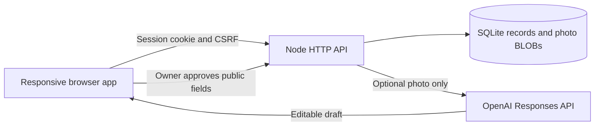

# SecondShelf

A working hackathon demo for remembering what you own, protecting sentimental belongings, and publishing unused items for sale or swap.

## GitHub Pages demo

The free Pages build runs entirely in the visitor's browser. It supports photos, inventory editing, sentimental protection, activity dates, search, suggestions, and a local Sell/Swap demonstration. It clearly labels this mode throughout the app.

- Records and resized photos are saved in **IndexedDB** on that browser/device. Reloading preserves them.
- The community is a **local demonstration**. Other visitors cannot see your listings; there is no shared database or account system.
- Clearing site data, ending a private browsing session, or browser storage cleanup can erase the shelf. There is no cloud backup.
- No AI service or API key is used in this mode. Keep/rehome suggestions use explicit rules.
- Only `public/` assets are deployed. Runtime databases, uploaded photos, `.env` files, and local documents are excluded.

Build and preview with Node.js 24:

```sh
node scripts/build-pages.mjs
node scripts/preview-pages.mjs
```

Open **http://127.0.0.1:4322/secondshelf/**. Previewing under this subpath checks the same URL layout used by a project site on GitHub Pages.

To publish, use a public GitHub repository with this source on `main`. In **Settings → Pages → Build and deployment → Source**, choose **GitHub Actions**. The included workflow tests both app modes, builds `dist/`, and deploys it when `main` changes. Its deployment summary provides the live URL. No packages, secrets, or hosting account are required beyond GitHub.

See [GitHub's Pages workflow documentation](https://docs.github.com/en/pages/getting-started-with-github-pages/using-custom-workflows-with-github-pages) for the hosting configuration. Pages serves static files; the full server version below is a separate deployment option.

## Run the full server version

Requires Node.js 24 or later. There are **no packages to install** for the app.

```sh
node server.mjs
```

Open **http://127.0.0.1:4321**. On this Windows computer, you can also double-click `Start SecondShelf.cmd`.

The server creates `data/secondshelf.sqlite` automatically. Keep the `data` folder to preserve records, images, sessions, and listings across restarts. Stop the server with Ctrl+C.

## What works

- Responsive inventory, review, protected-item, and community views.
- Real photo uploads, compressed in the browser and stripped of location metadata on the server.
- Create, edit, and delete inventory records; search by name or location; filter and sort.
- Optional attachment scale, private story, condition, and owner-estimated value in MYR.
- Separate last-used and last-moved dates, including unknown and approximate values.
- Explainable keep, use-again, and sell/swap suggestions. Protected or highly sentimental items remain protected from automatic rehoming suggestions.
- Explicit public previews; shared Sell or Swap listings; duplicate-publication prevention; withdrawal.
- A separate private inventory per browser session. Private records and image endpoints check ownership. Public listings contain approved snapshots.
- Real SQLite persistence, CSRF protection, parameterized queries, request limits, and a content security policy.
- An optional server-side OpenAI image-analysis adapter, with editable structured output, explicit owner approval, and manual fallback.

## Demo, sample data, and limitations

Each new browser session starts with eight fictional items and original SVG illustrations. Three sample community listings are also included. All starting prices, stories, histories, and people are fictional; sample records are labeled. New items use the photo you actually upload.

The default name is Jamie and the demo community is Taman Kita. Use the avatar to change your display name for future listings. A different browser or incognito window receives a separate inventory but sees the same published community feed.

The server version uses **anonymous browser sessions**, not production accounts. Sessions expire after 30 days, and clearing cookies loses access to that browser's space. There is no account recovery, moderation console, or public registration workflow. Use fictional inventory for a public server demo. These server-session rules do not apply to the browser-only Pages build.

Payments, messaging, interest requests, reservations, verified handovers, and automated market pricing are not included. The estimated-value card sums only eligible rehoming candidates with owner estimates, and shows coverage. It is not money earned.

## Optional live photo AI

Manual entry works without an account or API key. No model results are simulated.

1. Copy `.env.example` to `.env`.
2. Add your own `OPENAI_API_KEY` on the server. Keep `.env` out of source control.
3. Set `AI_MODEL` if needed; the supplied default is `gpt-4.1-mini`.
4. Restart the server. Upload a photo in the item form, choose **Suggest details from photo**, then review and apply the returned draft.

Only the photo and a neutral classification instruction go to the model. Private stories, locations, sentimental scores, and estimated prices are omitted. The model drafts name, category, description, and uncertainty notes. It cannot publish a listing. Requests time out after 10 seconds; manual entry remains available.

The adapter was tested against a mocked provider response. A live provider call has **not** been verified because no account/key was supplied. Connecting the provider may incur usage charges according to your account.

Official implementation references: [image inputs](https://developers.openai.com/api/docs/guides/images-vision), [structured outputs](https://developers.openai.com/api/docs/guides/structured-outputs), and [model capabilities](https://developers.openai.com/api/docs/models/gpt-4.1-mini).

## Two-minute walkthrough

1. Open **The little rice cooker**: low attachment and long inactivity produce a rehoming suggestion.
2. Open **Dad's film camera**: sentimental attachment and protection produce a Keep suggestion.
3. Add a real image, name, and storage location. Add a confirmed old last-used date and a low attachment level to get a review suggestion.
4. Choose **Sell or swap**, read the public preview, and publish. Private locations and stories are excluded.
5. View it in **Community**, then withdraw it. In the server version, another browser session can verify sharing; the Pages version deliberately keeps this demonstration local.
6. Show **Used today** and **Moved today** updating different fields.

## Architecture



The app uses native browser modules and a dependency-free Node server. SQL queries check ownership; listing records are separate public snapshots, including a separate photo snapshot. There is one active listing per item. Withdrawal deletes the public snapshot while retaining the private item.

Configuration: `HOST` (default `127.0.0.1`), `PORT` (default `4321`), `DATA_DIR` (default `./data`), `SECURE_COOKIES` (default `0`), `OPENAI_API_KEY`, and `AI_MODEL`.

## Deployment preparation

The included Dockerfile is ready for a provider that supports a Node container and persistent storage. This is needed only for the full shared version; GitHub Pages uses the static build described above. No container-hosting account has been created.

```sh
docker build -t secondshelf .
docker run --rm -p 4321:4321 -v secondshelf-data:/app/data secondshelf
```

For a hosted demo:

- Keep a single server instance and mount persistent storage at `/app/data`. SQLite data should not live on an ephemeral filesystem.
- Serve behind the provider's HTTPS proxy and set `SECURE_COOKIES=1`.
- Set `HOST=0.0.0.0` and the port required by the host; the Docker image already uses port 4321.
- Add an AI key through hosting secrets only if needed.
- Verify the live URL, real AI call, privacy checks, and public feed on two devices before submitting to judges.
- Use fictional data and review session recovery, moderation, rate limits, and retention before inviting real users.

## Verification

```sh
node --test tests/*.test.mjs
```

These tests exercise decision boundaries, ownership and photo access, CSRF/origin checks, activity updates, idempotent publication, public-field isolation, withdrawal, validation, metadata stripping, persistence, and the AI adapter using a mock provider.

`scripts/browser-smoke.mjs` runs the real UI at desktop and phone sizes. It requires Playwright and a Chromium browser; set `PLAYWRIGHT_PATH` to an installed package path and `CHROME_PATH` to a browser executable if automatic resolution does not work.

```sh
node scripts/browser-smoke.mjs
```

The browser checks cover upload, save, reload, recommendation, Sell on desktop, Swap on mobile, cross-session visibility, withdrawal, activity updates, deletion, empty-search recovery, overflow, and console errors. Screenshots and machine-run results are saved under `test-results/`. Automated form-fill times are test execution timings, not human usability measurements.

Browser-mode tests also cover local listing snapshots, activity updates, validation, storage-serializable photos, and the public build boundary. Implementation status is in `docs/BUILD_STATUS.md`. The original product requirements remain in the local `output/` folder and are excluded from publication.
